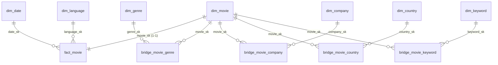

# BÁO CÁO ĐẶC TẢ SCHEMA DATA WAREHOUSE (DDS SCHEMA SPECIFICATION)

* **Dự án:** TMDB 5000 Movie Data Warehouse & BI Analytics System  
* **Người thực hiện:** Thịnh (Phụ trách Phần 3.3 – Data Warehouse)  
* **Ngày lập báo cáo:** 26/10/2026  
* **Mã nguồn DDL đính kèm:** [`postgres/init/02_dds_schema.sql`]

---

## 1. TỔNG QUAN VÀ MỤC ĐÍCH TÀI LIỆU

Tài liệu này đóng vai trò là **Data Contract (Hợp đồng dữ liệu)** chính thức giữa bộ phận Data Warehouse và bộ phận Transformation (dbt), xác nhận cấu trúc chi tiết của tầng **DDS (Dimensional Data Store / Star Schema)** trong hệ thống kho dữ liệu PostgreSQL.

Mục tiêu chính:
1. Xác nhận sự thống nhất giữa thiết kế mô hình hóa đa chiều (`modeling.pdf`) và triển khai vật lý thực tế.
2. Cung cấp danh mục từ điển dữ liệu (Data Dictionary) chi tiết: bảng, cột, kiểu dữ liệu, ràng buộc khóa chính/khóa ngoại.
3. Chuẩn hóa quy tắc sinh Surrogate Key, quy ước dòng dữ liệu Unknown (`SK = -1`), cơ chế trọng số `WeightFactor` và các công thức chỉ số tài chính để Tun triển khai các dbt models (`dimensions`, `bridge`, `facts`) đạt độ chính xác tuyệt đối.

---

## 2. XÁC NHẬN SCHEMA ĐÍCH VÀ QUY CÁCH ĐẶT TÊN

* **Database Engine:** PostgreSQL 17 (Docker container)
* **Schema đích:** `dds`
* **Quy chuẩn định danh (Naming Convention):**
  * Toàn bộ tên bảng và tên cột được chuẩn hóa sang định dạng **`snake_case`** (chữ thường, ngăn cách bằng dấu gạch dưới) để tránh xung đột case-sensitive trên PostgreSQL và tương thích tối đa với Jinja/SQL trong dbt.
  * Tiền tố bảng: `fact_*` (bảng dữ kiện), `dim_*` (bảng chiều), `bridge_*` (bảng cầu nối nhiều–nhiều).
  * Quy ước hậu tố khóa: `*_sk` (Surrogate Key), `*_nk` (Natural Key / Khóa nguồn TMDB).

### Danh sách các bảng trong Schema `dds`
| Loại bảng | Tên bảng thực tế | Tên thiết kế trong modeling.pdf | Quan hệ chính |
| :--- | :--- | :--- | :--- |
| **Fact** | `dds.fact_movie` | `FactMovie` | Nối với `dim_movie` (1–1), `dim_date`, `dim_language` |
| **Dimension Đơn trị** | `dds.dim_movie` | `DimMovie` | Điểm neo kết nối Fact và các Bridge |
| **Dimension Đơn trị** | `dds.dim_date` | `DimDate` | Phân cấp Date $\rightarrow$ Month $\rightarrow$ Quarter $\rightarrow$ Year $\rightarrow$ Decade |
| **Dimension Đơn trị** | `dds.dim_language` | `DimLanguage` | Phân cấp LanguageName $\rightarrow$ LanguageGroup |
| **Dimension Đa trị** | `dds.dim_genre` | `DimGenre` | N–N với Movie qua `bridge_movie_genre` |
| **Dimension Đa trị** | `dds.dim_company` | `DimCompany` | N–N với Movie qua `bridge_movie_company` |
| **Dimension Đa trị** | `dds.dim_country` | `DimCountry` | N–N với Movie qua `bridge_movie_country` |
| **Dimension Đa trị** | `dds.dim_keyword` | `DimKeyword` | N–N với Movie qua `bridge_movie_keyword` |
| **Bridge Table** | `dds.bridge_movie_genre` | `BridgeMovieGenre` | Có cột `weight_factor` |
| **Bridge Table** | `dds.bridge_movie_company` | `BridgeMovieCompany` | Có cột `weight_factor` |
| **Bridge Table** | `dds.bridge_movie_country` | `BridgeMovieCountry` | Có cột `weight_factor` |
| **Bridge Table** | `dds.bridge_movie_keyword` | `BridgeMovieKeyword` | **Không có** cột `weight_factor` |

---

## 3. TỪ ĐIỂN DỮ LIỆU CHI TIẾT (DATA DICTIONARY)

### 3.1. Bảng Dữ kiện trung tâm: `dds.fact_movie`
* **Mức độ chi tiết (Grain):** Mỗi dòng biểu diễn chính xác **một bộ phim điện ảnh duy nhất** tương ứng 1 bản ghi hợp lệ từ nguồn `tmdb_5000_movies.csv`. Đây là dạng **Periodic Snapshot / Accumulating Snapshot một lần**, không phải giao dịch liên tục.

| STT | Tên cột | Kiểu dữ liệu | Ràng buộc | Tính chất | Mô tả nghiệp vụ & Quy tắc tính |
| :---: | :--- | :--- | :---: | :---: | :--- |
| 1 | `movie_sk` | `INT` | PK, FK | - | Khóa ngoại trỏ đến `dim_movie(movie_sk)` (quan hệ 1-1). |
| 2 | `date_sk` | `INT` | FK, NOT NULL | - | Khóa ngày trỏ đến `dim_date(date_sk)`. Nếu thiếu `release_date` gán `-1`. |
| 3 | `language_sk` | `INT` | FK, NOT NULL | - | Khóa ngôn ngữ trỏ đến `dim_language(language_sk)`. |
| 4 | `budget` | `DECIMAL(18, 0)` | NULL | Additive | Ngân sách (USD). Nguồn bằng `0` phải chuyển thành `NULL`. |
| 5 | `revenue` | `DECIMAL(18, 0)` | NULL | Additive | Doanh thu (USD). Nguồn bằng `0` phải chuyển thành `NULL`. |
| 6 | `profit` | `DECIMAL(18, 0)` | NULL | Additive* | `revenue - budget`. NULL nếu budget hoặc revenue là NULL. |
| 7 | `roi` | `DECIMAL(18, 4)` | NULL | Non-additive | `profit / budget`. NULL nếu budget là NULL hoặc $\le 0$. |
| 8 | `runtime` | `NUMERIC(5, 1)` | NULL | Non-additive | Thời lượng phim tính bằng phút. |
| 9 | `popularity` | `DECIMAL(12, 6)` | NULL | Non-additive | Chỉ số độ phổ biến do TMDB ghi nhận. |
| 10 | `vote_average` | `DECIMAL(4, 1)` | NULL | Non-additive | Điểm đánh giá trung bình. NULL nếu `vote_count = 0`. |
| 11 | `vote_count` | `INT` | DEFAULT 0 | Additive | Tổng số lượt đánh giá ghi nhận. |
| 12 | `is_finance_valid` | `INT` | NOT NULL | Additive | `1` nếu có cả Budget > 0 và Revenue > 0; ngược lại `0`. |
| 13 | `is_revenue_over_budget` | `INT` | NOT NULL | Additive | `1` nếu `revenue > budget` (và `is_finance_valid = 1`); ngược lại `0`. |
| 14 | `movie_count` | `INT` | NOT NULL | Additive | Luôn bằng `1` để hỗ trợ phép đếm số lượng phim bằng hàm `SUM()`. |

---

### 3.2. Các Bảng Chiều Đơn Trị (Single-Value Dimensions)

#### A. `dds.dim_movie` (Quan hệ 1–1 với FactMovie)
Chứa các thuộc tính định danh và thuộc tính phân nhóm phim:
* `movie_sk` (`INT`, PK): Surrogate Key của bộ phim.
* `movie_nk` (`INT`, UNIQUE, NOT NULL): ID tự nhiên từ TMDB (`id` trong file movies).
* `title` (`TEXT`, NOT NULL): Tên phim hiển thị.
* `original_title` (`TEXT`): Tên phim ở ngôn ngữ gốc.
* `status` (`VARCHAR(50)`): Trạng thái phát hành (ví dụ: `Released`).
* `runtime_band` (`VARCHAR(50)`): Phân nhóm thời lượng phục vụ Câu hỏi phân tích 1:
  $$\text{runtime\_band} \in \{\text{'Dưới 90 phút'}, \text{'90–119 phút'}, \text{'120–149 phút'}, \text{'Từ 150 phút trở lên'}, \text{'Không rõ'}\}$$
* `budget_band` (`VARCHAR(50)`): Phân nhóm ngân sách phục vụ Câu hỏi phân tích 4:
  $$\text{budget\_band} \in \{\text{'Dưới 1 triệu USD'}, \text{'1–10 triệu'}, \text{'10–50 triệu'}, \text{'50–100 triệu'}, \text{'Từ 100 triệu trở lên'}, \text{'Không rõ'}\}$$
* `country_count` (`INT`): Tổng số quốc gia tham gia sản xuất.
* `country_type` (`VARCHAR(50)`): Phân loại hợp tác quốc tế:
  * `'Single-country'` nếu `country_count = 1`.
  * `'Multi-country'` nếu `country_count > 1`.
  * `'Unknown'` nếu không rõ hoặc `country_count = 0`.

#### B. `dds.dim_date`
Sinh từ trường `release_date`. Hỗ trợ phân tích thời gian theo phân cấp Date $\rightarrow$ Month $\rightarrow$ Quarter $\rightarrow$ Year $\rightarrow$ Decade:
* `date_sk` (`INT`, PK): Dạng số nguyên `YYYYMMDD` (VD: `20091210`). Bản ghi Unknown là `-1`.
* `full_date` (`DATE`): Ngày đầy đủ.
* `day` (`INT`): Ngày trong tháng (1–31).
* `month` (`INT`): Tháng dạng số (1–12), dùng so sánh tính mùa vụ (Câu 6).
* `month_name` (`VARCHAR(20)`): Tên tháng (January, February,...).
* `quarter` (`INT`): Quý (1–4).
* `year` (`INT`): Năm phát hành (1916–2017).
* `decade` (`VARCHAR(10)`): Thập niên dạng chuỗi (VD: `'1980s'`, `'1990s'`, `'2000s'`).

#### C. `dds.dim_language`
Sinh từ trường `original_language`:
* `language_sk` (`INT`, PK): Khóa thay thế.
* `language_nk` (`VARCHAR(10)`, UNIQUE, NOT NULL): Mã ISO 639-1 (VD: `en`, `fr`, `ja`).
* `language_name` (`VARCHAR(100)`): Tên ngôn ngữ đầy đủ.
* `language_group` (`VARCHAR(20)`, NOT NULL): Nhóm ngôn ngữ gồm `English` và `Non-English` (Câu 7).

---

### 3.3. Các Bảng Chiều Đa Trị & Bảng Cầu Nối (Multi-Value Dimensions & Bridges)

Do một bộ phim có thể thuộc nhiều thể loại, nhiều hãng sản xuất, quay tại nhiều quốc gia và gắn nhiều từ khóa, mô hình sử dụng kỹ thuật **Bridge Tables** để giải quyết quan hệ Nhiều - Nhiều (N–N):

#### A. Chiều Thể loại & Bridge
* **`dds.dim_genre`**:
  * `genre_sk` (`INT`, PK): Khóa thay thế (`-1` là Unknown).
  * `genre_nk` (`INT`, UNIQUE, NOT NULL): ID thể loại từ JSON TMDB.
  * `genre_name` (`VARCHAR(100)`, NOT NULL): Tên thể loại (Action, Adventure, Comedy,...).
* **`dds.bridge_movie_genre`**:
  * `movie_sk` (`INT`, FK trỏ về `dim_movie`).
  * `genre_sk` (`INT`, FK trỏ về `dim_genre`).
  * `weight_factor` (`DECIMAL(18, 10)`, NOT NULL): Trọng số phân bổ bằng $1/k$ ($k$ là số thể loại của phim).
  * **Primary Key:** Composite `(movie_sk, genre_sk)`.

#### B. Chiều Hãng sản xuất & Bridge
* **`dds.dim_company`**:
  * `company_sk` (`INT`, PK): Khóa thay thế (`-1` là Unknown).
  * `company_nk` (`INT`, UNIQUE, NOT NULL): ID hãng sản xuất từ TMDB.
  * `company_name` (`VARCHAR(255)`, NOT NULL): Tên hãng (Warner Bros., Universal Pictures,...).
* **`dds.bridge_movie_company`**:
  * `movie_sk` (`INT`, FK trỏ về `dim_movie`).
  * `company_sk` (`INT`, FK trỏ về `dim_company`).
  * `weight_factor` (`DECIMAL(18, 10)`, NOT NULL): Trọng số $1/k$ ($k$ là số hãng sản xuất của phim).
  * **Primary Key:** Composite `(movie_sk, company_sk)`.

#### C. Chiều Quốc gia & Bridge
* **`dds.dim_country`**:
  * `country_sk` (`INT`, PK): Khóa thay thế (`-1` là Unknown).
  * `country_code` (`VARCHAR(10)`, UNIQUE, NOT NULL): Mã ISO 3166-1 (US, GB, FR,...).
  * `country_name` (`VARCHAR(100)`, NOT NULL): Tên quốc gia.
  * `region` (`VARCHAR(100)`): Châu lục/Vùng lãnh thổ (North America, Europe, Asia,...).
* **`dds.bridge_movie_country`**:
  * `movie_sk` (`INT`, FK trỏ về `dim_movie`).
  * `country_sk` (`INT`, FK trỏ về `dim_country`).
  * `weight_factor` (`DECIMAL(18, 10)`, NOT NULL): Trọng số $1/k$ ($k$ là số quốc gia sản xuất của phim).
  * **Primary Key:** Composite `(movie_sk, country_sk)`.

#### D. Chiều Từ khóa & Bridge (Lưu ý đặc thù)
* **`dds.dim_keyword`**:
  * `keyword_sk` (`INT`, PK): Khóa thay thế (`-1` là Unknown).
  * `keyword_nk` (`INT`, UNIQUE, NOT NULL): ID từ khóa từ TMDB.
  * `keyword_name` (`VARCHAR(255)`, NOT NULL): Tên từ khóa.
  * `theme_group` (`VARCHAR(50)`, NOT NULL): Nhóm chủ đề phục vụ Câu 8 gồm: `Sequel`, `Adaptation`, `Superhero`, `Other` (gán qua dbt seed).
* **`dds.bridge_movie_keyword`**:
  * `movie_sk` (`INT`, FK trỏ về `dim_movie`).
  * `keyword_sk` (`INT`, FK trỏ về `dim_keyword`).
  * **Primary Key:** Composite `(movie_sk, keyword_sk)`.
  * **LƯU Ý:** **Không có cột `weight_factor`** vì từ khóa là nhãn gán kèm (tagging), không dùng để phân bổ giá trị tài chính.

---

## 4. QUY ƯỚC DỮ LIỆU THIẾU (UNKNOWN HANDLING) & DÒNG MẶC ĐỊNH

Nhằm đảm bảo tính toàn vẹn tham chiếu (Referential Integrity) và ngăn chặn việc mất dữ liệu khi Power BI áp dụng bộ lọc (Inner Join / Cross Filter):

1. **Khởi tạo bản ghi Unknown (`SK = -1`):**  
   File DDL đã chèn sẵn các bản ghi Unknown mặc định trong schema `dds`:
   * `dds.dim_date`: `date_sk = -1`, `decade = 'Unknown'`, `month_name = 'Unknown'`.
   * `dds.dim_language`: `language_sk = -1`, `language_nk = 'unk'`, `language_name = 'Unknown'`, `language_group = 'Non-English'`.
   * `dds.dim_genre`: `genre_sk = -1`, `genre_name = 'Unknown'`.
   * `dds.dim_company`: `company_sk = -1`, `company_name = 'Unknown'`.
   * `dds.dim_country`: `country_sk = -1`, `country_name = 'Unknown'`, `region = 'Unknown'`.
   * `dds.dim_keyword`: `keyword_sk = -1`, `keyword_name = 'Unknown'`, `theme_group = 'Other'`.

2. **Quy tắc dbt xử lý dữ liệu nguồn rỗng hoặc thiếu:**
   * Phim thiếu `release_date` $\rightarrow$ gán `date_sk = -1`.
   * Phim thiếu `runtime` $\rightarrow$ gán `runtime_band = 'Không rõ'`.
   * **Mảng JSON rỗng:** Nếu phim có mảng JSON thể loại, hãng sản xuất, hoặc quốc gia rỗng (`[]`), dbt phải sinh ra **1 dòng bản ghi trong bảng Bridge tương ứng trỏ về `SK = -1`** với `weight_factor = 1.0`.

---

## 5. QUY TẮC TRIỂN KHAI WEIGHTFACTOR & TÍNH TOÁN TÀI CHÍNH

### 5.1. Triển khai WeightFactor trong dbt
* Đối với mỗi bảng bridge (Genre, Company, Country), khi dbt bóc tách JSON bằng `jsonb_array_elements`:
  ```sql
  -- Công thức mẫu tính WeightFactor trong dbt model bridge
  1.0::decimal(18, 10) / COUNT(*) OVER (PARTITION BY movie_sk) AS weight_factor
  ```
* **Tính chất bất biến:** Tổng trọng số của 1 phim trong 1 bảng bridge luôn thỏa mãn:
  $$\sum \text{weight\_factor} = 1.0$$
* Phục vụ hai phương pháp phân tích trên Power BI:
  * **TH1 (Full Credit):** Bỏ qua `weight_factor`, tính trọn vẹn giá trị cho từng thành viên (thích hợp cho tính trung vị, tỷ lệ ROI, đếm số lượng phim).
  * **TH2 (Fractional Allocation):** Nhân chỉ số tài chính với `weight_factor` ($\text{Allocated Profit} = \sum (\text{weight\_factor} \times \text{profit})$), giúp tổng cộng các thành phần khớp 100% với doanh thu/lợi nhuận thực tế của doanh nghiệp.

### 5.2. Logic tính toán các Measure tài chính trong `FactMovie`
* **Xử lý số 0:** `budget = 0` hoặc `revenue = 0` là thiếu dữ liệu $\rightarrow$ Ép kiểu sang **`NULL`**.
* **Lợi nhuận (`profit`):**
  $$\text{profit} = \text{revenue} - \text{budget} \quad (\text{Trả về NULL nếu một trong hai giá trị là NULL})$$
* **Tỷ suất sinh lời (`roi`):**
  $$\text{roi} = \frac{\text{profit}}{\text{budget}} \quad (\text{Trả về NULL nếu budget là NULL hoặc } \le 0)$$
* **Cờ hợp lệ tài chính (`is_finance_valid`):**
  ```sql
  CASE 
      WHEN budget IS NOT NULL AND budget > 0 AND revenue IS NOT NULL AND revenue > 0 THEN 1 
      ELSE 0 
  END AS is_finance_valid
  ```
* **Cờ vượt ngân sách (`is_revenue_over_budget`):**
  ```sql
  CASE 
      WHEN is_finance_valid = 1 AND revenue > budget THEN 1 
      ELSE 0 
  END AS is_revenue_over_budget
  ```

---

## 6. SƠ ĐỒ MỐI QUAN HỆ STAR SCHEMA (ERD)



---

## 7. KẾ HOẠCH PHỐI HỢP & TIÊU CHÍ NGHIỆM THU GIỮA THỊNH VÀ TUN

| Giai đoạn | Thời gian | Nhiệm vụ của Tun (dbt) | Nhiệm vụ của Thịnh (DW) | Tiêu chí nghiệm thu |
| :--- | :---: | :--- | :--- | :--- |
| **Giai đoạn 1** | 26–27/10 | Kiểm tra Staging; áp dụng schema này để viết các model dbt. | Cung cấp file DDL; rà soát khóa và kiểu dữ liệu. | Hai bên chốt 100% schema. Không còn sai lệch kiểu dữ liệu hay tên cột. |
| **Giai đoạn 2** | 28–29/10 | Viết logic bóc tách JSON và tính `weight_factor`. | Kiểm tra ràng buộc và hỗ trợ sửa lỗi cấu trúc. | Chạy thành công `dbt run` thử nghiệm trên các bảng chính. |
| **Giai đoạn 3** | 30–31/10 | Chạy `dbt test` (unique, not_null, relationships). | Chạy script SQL kiểm tra: tính hợp lệ khóa ngoại, tổng `weight_factor = 1.0`, số dòng Fact = ~4.803. | Dữ liệu nạp đầy đủ vào schema `dds` trên PostgreSQL, sẵn sàng cho Power BI. |

---

*File tài liệu đã được lưu trữ tại thư mục dự án để làm bằng chứng nghiệm thu và phục vụ làm báo cáo tổng hợp đồ án.*
